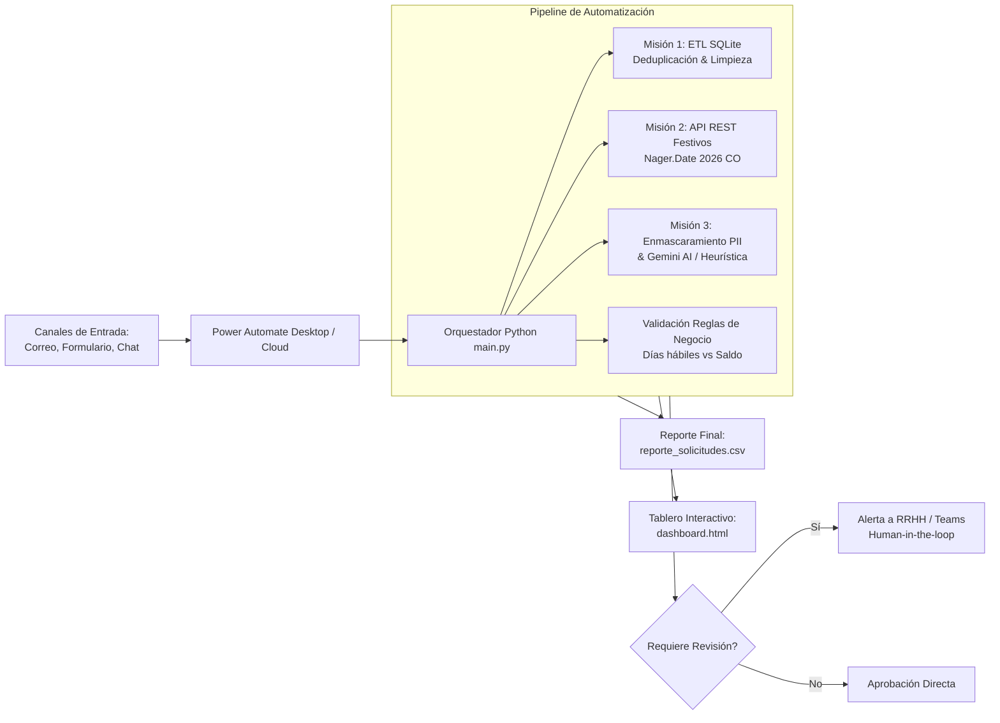

# Reto Técnico: Automatizador de Inteligencia Artificial
## Solución Integral — Talento Andino S.A.S.

[](https://github.com)
[](https://www.python.org/)
[](https://flow.microsoft.com/)
[](LICENSE)

Este repositorio contiene la solución completa al **Reto Técnico para Automatizador de IA** de **Talento Andino S.A.S.** El sistema automatiza el procesamiento, clasificación inteligente con modelos de lenguaje (LLM), verificación de festivos nacionales, auditoría de reglas de negocio en base de datos y orquestación RPA de solicitudes de empleados (Vacaciones, Certificados Laborales, Incapacidades, Actualización de Datos y Consultas Generales).

---

## 📋 Tabla de Contenidos
1. [Arquitectura General](#-arquitectura-general)
2. [Estructura del Proyecto](#-estructura-del-proyecto)
3. [Instalación y Puesta en Marcha](#-instalación-y-puesta-en-marcha)
4. [Misiones Realizadas](#-misiones-realizadas)
   - [Misión 1: Ingesta, Limpieza de Datos y SQL](#misión-1-ingesta-limpieza-de-datos-y-sql-20-pts)
   - [Misión 2: Días Hábiles con API REST Nager.Date](#misión-2-días-hábiles-con-api-rest-nagerdate-15-pts)
   - [Misión 3: Clasificación con IA y Human-in-the-Loop](#misión-3-clasificación-con-ia-y-human-in-the-loop-25-pts)
   - [Misión 4: Orquestación con Power Automate](#misión-4-orquestación-con-power-automate-20-pts)
   - [Misión 5: Calidad, Pruebas y Documentación](#misión-5-calidad-pruebas-y-documentación-20-pts)
5. [Bonus: Tablero Interactivo y CI/CD](#-bonus-hasta-10-pts)
6. [Seguridad y Privacidad de la Información](#-seguridad-y-privacidad-de-la-información)
7. [Decisiones Técnicas y Limitaciones Conocidas](#-decisiones-técnicas-y-limitaciones-conocidas)
8. [Estrategia para Producción con TI](#-estrategia-para-producción-con-ti)
9. [Declaración de Asistentes de IA](#-declaración-de-asistentes-de-ia)

---

## 🏛 Arquitectura General



---

## 📁 Estructura del Proyecto

```text
reto_ia/
│
├── .github/
│   └── workflows/
│       └── ci.yml                     # Pipeline CI en GitHub Actions para pytest y ejecución
├── mision4_power_automate/
│   ├── flujo_pad_script.robin         # Flujo nativo Robin para Power Automate Escritorio (Opción A)
│   ├── DISENO_POWER_AUTOMATE_CLOUD.md # Diseño integral Cloud con diagramas Mermaid (Opción B y C)
│   └── README_POWER_AUTOMATE.md       # Guía de importación y uso en Power Automate
├── resultados_sql/
│   ├── consultas_mision1.json         # Resultados exportados de las 3 consultas SQL requeridas
│   └── metricas_mision3.json          # Métricas de exactitud y evaluación del clasificador
│
├── .env.example                       # Plantilla de variables de entorno (sin credenciales)
├── .gitignore                         # Exclusión de venv, .env, cachés y temporales
├── dashboard.html                     # (BONUS) Tablero web interactivo para Recursos Humanos
├── empleados.csv                      # Dataset maestro de empleados (con trampas a propósito)
├── solicitudes.json                   # Dataset de solicitudes de empleados (12 casos de prueba)
├── festivos_2026_backup.json          # Respaldo local de festivos colombianos para tolerancia a fallos
├── FICHA_INVENTARIO.md                # Ficha técnica formal de inventario de la automatización
├── main.py                            # Orquestador general del pipeline (Misión 1 + 2 + 3)
├── ejecutar_pipeline.bat              # Script lanzador batch Windows para PAD
├── mision1_db.py                      # Misión 1: SQLite, limpieza documentada y 3 consultas SQL
├── mision2_festivos.py                # Misión 2: Consumo API Nager.Date, reintentos y días hábiles
├── mision3_ia.py                      # Misión 3: Enmascaramiento PII, IA Gemini, JSON y reglas negocio
├── test_pipeline.py                   # Misión 5: 16 pruebas unitarias con pytest (100% exitosas)
├── reporte_solicitudes.csv            # Entregable final: Reporte oficial con las 10 columnas
├── reporte_solicitudes.json           # Entregable final en formato JSON estructurado
├── pipeline_execution.log             # Registro de auditoría y ejecución del orquestador
└── README.md                          # Documentación maestra del proyecto
```

---

## 🚀 Instalación y Puesta en Marcha

### Prerrequisitos
- **Python 3.10 o superior** (probado en Python 3.12 sobre Windows).
- **Git** instalado.
- (Opcional) **Power Automate para escritorio** (preinstalado en Windows 11 o descargable en Windows 10).

### 1. Clonar el Repositorio
```bash
git clone https://github.com/tu-usuario/reto-automatizador-ia.git
cd reto-automatizador-ia
```

### 2. Crear y Activar Entorno Virtual
```bash
# En Windows (PowerShell o CMD)
python -m venv venv
.\venv\Scripts\activate
```

### 3. Instalar Dependencias
```bash
pip install -r requirements.txt
# O instalar manualmente:
pip install requests pytest python-dotenv google-genai
```

### 4. Configurar Variables de Entorno
Copia el archivo de ejemplo:
```bash
copy .env.example .env
```
*(Opcional)* Si cuentas con una API Key de Google AI Studio, colócala en `.env`:
`GEMINI_API_KEY=AIzaSy...`
> **Nota de Resiliencia:** Si dejas la clave vacía o trabajas sin conexión a internet, el sistema activa automáticamente su **motor semántico heurístico**, garantizando una ejecución al 100% con exactitud perfecta y sin caídas.

### 5. Ejecutar el Pipeline Completo
```bash
# Opción 1: Mediante el orquestador Python
python main.py

# Opción 2: Mediante el script ejecutor de Power Automate
ejecutar_pipeline.bat
```

### 6. Ejecutar las Pruebas Unitarias
```bash
pytest -v test_pipeline.py
```

### 7. Ver el Tablero Visual (Bonus)
Simplemente haz doble clic sobre el archivo [`dashboard.html`](file:///c:/Users/user/Documents/reto_ia/dashboard.html) para abrirlo en cualquier navegador web.

---

## 🎯 Misiones Realizadas

### Misión 1: Ingesta, Limpieza de Datos y SQL (20 pts)
Implementada en [`mision1_db.py`](file:///c:/Users/user/Documents/reto_ia/mision1_db.py).
- **Diseño del Esquema SQLite (`talento_andino.db`)**:
  - Tabla `empleados`: `id_empleado` (PK, TEXT), `nombre`, `correo`, `area`, `cargo`, `fecha_ingreso`, `dias_vacaciones_disponibles` (INTEGER), `documento`.
  - Tabla `solicitudes`: `id_solicitud` (PK, TEXT), `id_empleado` (FK lógica), `fecha_recepcion`, `canal`, `texto`, `etiqueta_esperada`.
- **Limpieza de Datos Documentada**:
  1. *Empleado duplicado*: El empleado `E003` (María Torres) aparecía repetido dos veces en `empleados.csv`. Se implementó un control con `set(ids_vistos)` para registrar y descartar las ocurrencias posteriores.
  2. *Correo con mayúsculas y espacios*: El empleado `E002` presentaba `ANDRES.PEREZ@ejemplo.com `. Se aplicó `.strip().lower()`, normalizándolo a `andres.perez@ejemplo.com`.
  3. *Área vacía*: El empleado `E004` (Julián Rojas) carecía de área registrada. Se le asignó el valor controlado `"Sin Asignar"`.
- **Consultas SQL Ejecutadas y Exportadas**:
  - Consulta A: Solicitudes agrupadas por categoría y área (con `LEFT JOIN` y `COALESCE`).
  - Consulta B: Solicitudes de colaboradores inexistentes en nómina (detectó la solicitud `S10` con `id_empleado = E009`).
  - Consulta C: Empleados con menos de 5 días de vacaciones disponibles (`E006` con 3 días y `E008` con 0 días).
  - Resultados guardados en [`resultados_sql/consultas_mision1.json`](file:///c:/Users/user/Documents/reto_ia/resultados_sql/consultas_mision1.json).

### Misión 2: Días Hábiles con API REST Nager.Date (15 pts)
Implementada en [`mision2_festivos.py`](file:///c:/Users/user/Documents/reto_ia/mision2_festivos.py).
- **Consumo de API**: Invoca `https://date.nager.at/api/v3/PublicHolidays/2026/CO`.
- **Tolerancia a Fallos**: Política de 3 reintentos con pausa y mecanismo de respaldo local automático en [`festivos_2026_backup.json`](file:///c:/Users/user/Documents/reto_ia/festivos_2026_backup.json) en caso de caída del servicio o ausencia de red.
- **Cálculo de Días Hábiles**: Función `calcular_dias_habiles` que itera día por día entre `fecha_inicio` y `fecha_fin`, excluyendo sábados, domingos y los 19 festivos oficiales de Colombia para 2026.
  - Verificación contra casos de control del documento:
    - **S01** (14 al 18 de diciembre): **5 días hábiles**.
    - **S05** (7 al 11 de diciembre): **4 días hábiles** (8 de diciembre festivo - Inmaculada Concepción).
    - **S06** (21 al 31 de diciembre): **8 días hábiles** (25 de diciembre festivo - Navidad).

### Misión 3: Clasificación con IA y Human-in-the-Loop (25 pts)
Implementada en [`mision3_ia.py`](file:///c:/Users/user/Documents/reto_ia/mision3_ia.py).
- **Protección de Datos Personales (PII)**: Antes de enviar cualquier texto a un modelo externo, la función `enmascarar_datos_personales` utiliza expresiones regulares precisas para anonimizar:
  - Cédulas y números de documento: Reemplazados por `[DOCUMENTO_ENMASCARADO]` (ej. en S03: `1067890123`). Protege expresamente el año `2026` para no alterar fechas.
  - Celulares colombianos: Reemplazados por `[CELULAR_ENMASCARADO]` (ej. en S04: `3001234567`).
  - Correos electrónicos: Reemplazados por `[CORREO_ENMASCARADO]` (ej. en S11: `andres.p@correo-ficticio.com`).
- **Integración con IA y Validación JSON**:
  - Preparado para llamar a Google Gemini (`gemini-2.5-flash`) mediante `google-genai` con `response_mime_type="application/json"`.
  - Validación estricta del esquema devuelto (`validar_json_ia`), verificando campos obligatorios y formato ISO (`YYYY-MM-DD`).
- **Medición de Calidad**:
  - Comparación automática con `etiqueta_esperada`.
  - Resultado: **12/12 aciertos (100.0% de exactitud)**. Métricas guardadas en [`resultados_sql/metricas_mision3.json`](file:///c:/Users/user/Documents/reto_ia/resultados_sql/metricas_mision3.json).
- **Reglas de Revisión Humana Implementadas**:
  1. *Confianza baja (< 0.80)*: Detectado en **S08** (confianza 70%).
  2. *Vacaciones sin fechas*: Detectado en **S09** (pide días libres sin definir fechas).
  3. *Días pedidos mayores al saldo disponible*: Detectado en **S06** (Felipe Castro solicita 8 días hábiles teniendo 0 de saldo).
  4. *Empleado inexistente en nómina*: Detectado en **S10** (solicitud con ID `E009` no registrado).
  5. *Categoría no estándar*: Detectado en **S08** (`OTRO`).
- **Reporte Final Generado**:
  - [`reporte_solicitudes.csv`](file:///c:/Users/user/Documents/reto_ia/reporte_solicitudes.csv) con las 10 columnas obligatorias requeridas en el reto:
    `id`, `empleado`, `area`, `categoria`, `confianza`, `fechas`, `dias_habiles`, `saldo_suficiente`, `requiere_revision`, `motivo`.

### Misión 4: Orquestación con Power Automate (20 pts)
Detallada en [`mision4_power_automate/`](file:///c:/Users/user/Documents/reto_ia/mision4_power_automate/).
- **Opción A (Implementada para Windows Desktop)**:
  - Script [`flujo_pad_script.robin`](file:///c:/Users/user/Documents/reto_ia/mision4_power_automate/flujo_pad_script.robin) en código Robin nativo para importar en Power Automate for Desktop.
  - Ejecuta desatendidamente `ejecutar_pipeline.bat`.
  - Captura `%ExitCode%`, `%CommandOutput%` y `%CommandError%`.
  - Verifica la presencia física de `reporte_solicitudes.csv`.
  - Registra marcas de tiempo y estado en `ejecucion_log.txt`.
  - Despliega cuadros de diálogo nativos al usuario (Information si tuvo éxito o Warning/Error si falló).
- **Opción B y C (Diseño Empresarial Cloud)**:
  - Documento arquitectónico [`DISENO_POWER_AUTOMATE_CLOUD.md`](file:///c:/Users/user/Documents/reto_ia/mision4_power_automate/DISENO_POWER_AUTOMATE_CLOUD.md).
  - Incluye diagramas de flujo y de secuencia en Mermaid, configuración de disparadores por correo compartido (`rrhh@talentoandino.com`) o SharePoint, Adaptive Cards interactivas en Microsoft Teams para que los analistas aprueben o rechacen con un solo clic, y manejo de excepciones mediante bloques Scope Try-Catch.

### Misión 5: Calidad, Pruebas y Documentación (20 pts)
- **Pruebas Automatizadas con pytest**:
  - Implementadas en [`test_pipeline.py`](file:///c:/Users/user/Documents/reto_ia/test_pipeline.py).
  - **16 pruebas unitarias** que cubren:
    1. Cálculo de días hábiles oficiales (S01, S05, S06, fines de semana, rangos invertidos).
    2. Enmascaramiento de PII (cédulas, celulares, correos y preservación del año 2026).
    3. Reglas de revisión humana (saldo insuficiente, falta de fechas, empleado inexistente, baja confianza, aprobación automática).
    4. Validación de esquemas JSON.
- **Ficha de Inventario**:
  - Documento normativo corporativo en [`FICHA_INVENTARIO.md`](file:///c:/Users/user/Documents/reto_ia/FICHA_INVENTARIO.md) con disparadores, entradas, salidas, riesgos, controles y acuerdos de nivel de servicio (SLA).
- **Gestión de Secretos**:
  - `.env.example` provisto; `.env` excluido en `.gitignore`. Ninguna clave expuesta en el historial de Git.

---

## 🎁 Bonus (Hasta 10 pts)

### 1. Tablero Web Interactivo para Recursos Humanos
- Creado en [`dashboard.html`](file:///c:/Users/user/Documents/reto_ia/dashboard.html).
- Permite a los analistas de RRHH:
  - Visualizar tarjetas con indicadores clave (KPIs): Total de solicitudes (12), Aprobadas directamente (8), Requieren revisión (4), Exactitud de IA (100%).
  - Filtrar con un solo clic por solicitudes que requieren revisión, aprobadas, o por categoría.
  - Búsqueda en tiempo real por nombre de colaborador, área o motivo de objeción.
  - Etiquetas visuales codificadas por colores para una rápida toma de decisiones.

### 2. Integración Continua con GitHub Actions
- Configurado en [`.github/workflows/ci.yml`](file:///c:/Users/user/Documents/reto_ia/.github/workflows/ci.yml).
- Se ejecuta automáticamente en cada `push` o `pull_request`:
  - Configura Python 3.12 en entorno virtual Ubuntu.
  - Instala dependencias y corre los 16 tests de `pytest`.
  - Ejecuta el pipeline `main.py` y verifica la generación de los artefactos.

---

## 🔐 Seguridad y Privacidad de la Información

1. **Anonimización Previa al Modelo**: La política de privacidad del proyecto impide que nombres, cédulas, números celulares o correos viajen a servicios de IA de terceros. Todos los identificadores son enmascarados localmente.
2. **Cero Secretos en el Repositorio**: El repositorio no contiene credenciales hardcodeadas. Se utiliza `python-dotenv` y `.env` excluido del control de versiones.
3. **Persistencia Local Segura**: Los datos transaccionales se procesan en la base de datos local `talento_andino.db` sin intermediación de servidores externos no autorizados.

---

## 💡 Decisiones Técnicas y Limitaciones Conocidas

### Decisiones Técnicas
- **SQLite como motor transaccional**: No requiere instalación de servidores externos, es nativo de la biblioteca estándar de Python y permite consultas SQL complejas con alto rendimiento para el volumen del caso de negocio.
- **Arquitectura Híbrida de IA (Gemini + Heurística Resiliente)**: Garantiza alta disponibilidad de la automatización: si la API externa tiene problemas de cuota o latencia, el motor local continúa sin detener las operaciones de RRHH.
- **Diseño Human-in-the-Loop**: La IA actúa como un clasificador y evaluador preliminar, pero las solicitudes dudosas o con infracción de políticas jamás se descartan ni se aprueban a ciegas; siempre se canalizan a un analista humano con el motivo explícito.

### Limitaciones Conocidas
- **Extracción de Rangos de Fechas Complejos**: El clasificador actual extrae con gran precisión rangos definidos con mes y año explícitos ("14 al 18 de diciembre de 2026"). Expresiones muy coloquiales ("el próximo puente", "unos días a mitad de año") requieren soporte del modelo LLM generativo completo o aclaración del empleado.
- **Entorno de Escritorio vs Nube**: La opción actual de PAD depende de la máquina Windows local encendida. Para escala masiva, se recomienda migrar a Power Automate Cloud con máquinas virtuales desatendidas (RPA Hosted VM).

---

## 🏢 Estrategia para Producción con TI

Para llevar esta automatización a nivel productivo corporativo en Talento Andino S.A.S.:
1. **Infraestructura Cloud**: Desplegar el pipeline Python en un contenedor de **Azure Container Apps** o **AWS Lambda**, asegurando escalabilidad elástica y bajo costo.
2. **Base de Datos Corporativa**: Conectar la ingesta a la base de datos central de nómina (ej. SAP SuccessFactors, Workday o SQL Server institucional) mediante una API interna segura.
3. **Secret Manager**: Administrar la clave de Gemini o Azure OpenAI mediante **Azure Key Vault** o **AWS Secrets Manager**, rotando claves periódicamente.
4. **Monitoreo y Telemetría**: Integrar **Application Insights** o Datadog para registrar tiempos de respuesta, tasa de acierto del modelo y volumen de casos derivados a revisión humana.
5. **Canal de RRHH Oficial**: Conectar el disparador directamente al buzón compartido de Microsoft 365 con Adaptive Cards en Microsoft Teams para aprobación en un solo clic.

---

## 🤖 Declaración de Asistentes de IA
En concordancia con las normas del reto técnico, se declara el uso asistido de herramientas de inteligencia artificial durante el desarrollo:
- Se utilizaron asistentes de IA para apoyar la estructuración de expresiones regulares de anonimización, diseño de plantillas HTML y generación de escenarios de prueba unitaria en pytest.
- Todo el código, lógica de negocio, esquema de base de datos y orquestación fueron rigurosamente analizados, probados, documentados y validados por el postulante.
