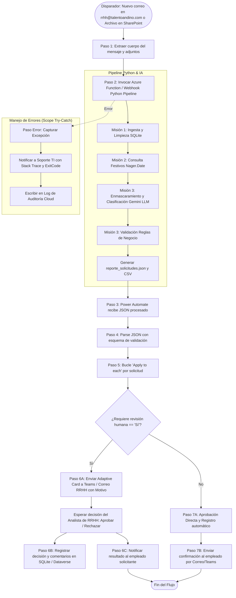
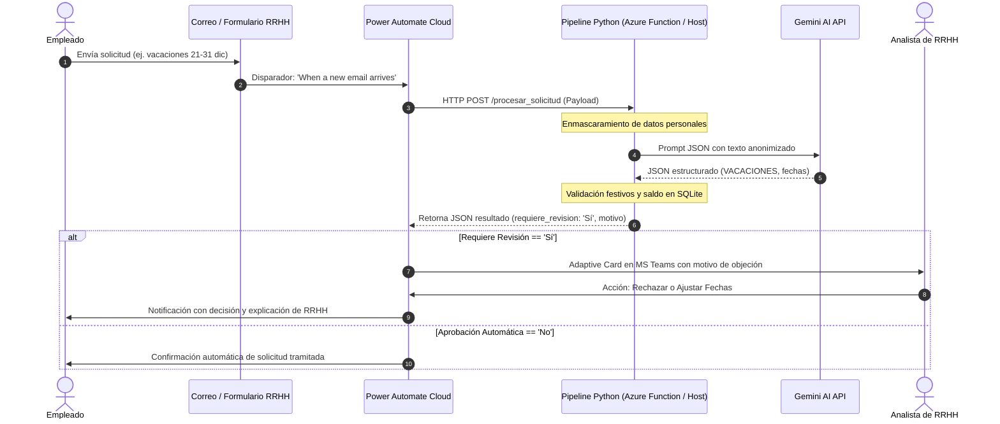

# Diseño de Arquitectura: Power Automate en la Nube (Opción B y C)
## Talento Andino S.A.S. — Sistema de Automatización de Solicitudes con IA y Human-in-the-Loop

---

### 1. Resumen Ejecutivo
Para dar cumplimiento a la **Misión 4 (Opción B y C)**, este documento presenta el diseño técnico integral de la orquestación en la nube mediante **Power Automate Cloud**. El flujo se activa ante la llegada de nuevas solicitudes (vía correo de RRHH o archivo en SharePoint/OneDrive), orquesta la ejecución del pipeline con IA, analiza los resultados estructurados y canaliza automáticamente las solicitudes que requieren revisión humana hacia los analistas de Recursos Humanos mediante **Adaptive Cards en Microsoft Teams** o correos interactivos de Outlook.

---

### 2. Diagrama de Flujo del Proceso en la Nube (Mermaid Flowchart)



---

### 3. Diagrama de Secuencia (Interacción de Componentes)



---

### 4. Especificación Detallada de Pasos del Flujo

#### Disparador (Trigger)
- **Opción Correo**: `When a new email arrives (V3)`
  - *Buzón compartido*: `rrhh@talentoandino.com`
  - *Filtro de asunto*: `[Solicitud RRHH]`
- **Opción Archivo**: `When a file is created in a folder (SharePoint / OneDrive)`
  - *Carpeta*: `/TalentoAndino/Solicitudes_Entrantes/`

#### Acción 1: Invocación del Pipeline (HTTP Connector / Azure Automation)
- **Método**: `POST`
- **URI**: `https://api.talentoandino.com/api/v1/pipeline/procesar`
- **Headers**: `Content-Type: application/json`, `X-API-KEY: @{parameters('SecretToken')}`
- **Body**: `@triggerOutputs()?['body']`

#### Acción 2: Parse JSON (Esquema de Validación)
```json
{
  "type": "array",
  "items": {
    "type": "object",
    "properties": {
      "id": { "type": "string" },
      "empleado": { "type": "string" },
      "area": { "type": "string" },
      "categoria": { "type": "string" },
      "confianza": { "type": "number" },
      "fechas": { "type": "string" },
      "dias_habiles": { "type": "integer" },
      "saldo_suficiente": { "type": "string" },
      "requiere_revision": { "type": "string" },
      "motivo": { "type": "string" }
    },
    "required": ["id", "categoria", "requiere_revision", "motivo"]
  }
}
```

#### Acción 3: Condición y Enrutamiento Human-in-the-Loop
- **Condición**: `items('Apply_to_each')?['requiere_revision']` es igual a `'Sí'`
- **Acción Sí**:
  - Enviar Adaptive Card a Microsoft Teams (Canal *RRHH - Casos Pendientes*):
    - Título: `⚠️ Caso en Revisión: Solicitud @{items('Apply_to_each')?['id']}`
    - Campos visibles: Empleado, Área, Categoría, Días Hábiles, Motivo del Flag.
    - Botones de acción: `[Aprobar Excepcionalmente]`, `[Rechazar Solicitud]`, `[Solicitar Aclaración al Empleado]`.
- **Acción No**:
  - Actualizar sistema nómina / Enviar email de confirmación automática.

---

### 5. Estrategia de Manejo de Errores (Scope Try / Catch / Finally)
1. **Scope Try**: Contiene la llamada HTTP, la serialización JSON y la escritura de logs.
2. **Scope Catch** (configurado con `runAfter: has failed, has timed out`):
   - Captura el error devuelto por la API o el entorno de ejecución.
   - Envía notificación crítica a `soporte.ti@talentoandino.com` con el identificador de ejecución (`workflow().run.id`).
   - Escribe en una lista de SharePoint de errores de auditoría.
3. **Scope Finally**: Registra métricas de tiempo de ejecución y cantidad de solicitudes procesadas.
